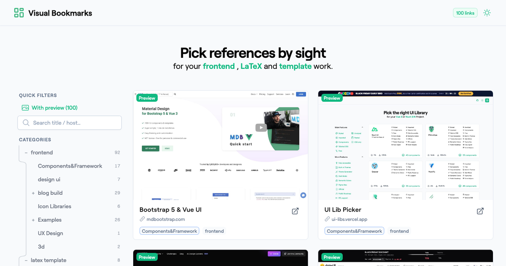

# Visual Bookmarks

[](https://wangzh12023.github.io/visual-bookmarks/)
[](./LICENSE)
[](https://nuxt.com/)
[](https://wangzh12023.github.io/visual-bookmarks/)

**English** | [简体中文](./README.zh-CN.md)

> Pick design & template references **by sight**, not by caption.

A visual gallery for frontend / UI / animation inspiration and LaTeX templates. Browse curated bookmarks with preview screenshots and a collapsible category tree — so you can walk through collections the way you actually choose references.

<p align="center">
  <a href="https://wangzh12023.github.io/visual-bookmarks/">
    
  </a>
</p>

## Why

Bookmark bars are text-only. When you’re building a new site, opening every saved link just to remember how it looked is slow. Visual Bookmarks turns those links into a **filterable screenshot gallery**.

## Features

- **Sight-first cards** — representative preview images for each bookmark
- **Collapsible category tree** — nested folders with clear hierarchy (frontend, examples, LaTeX templates, …)
- **Quick filters** — search + “with preview”
- **Nuxt UI look & feel** — based on the excellent [ui-libs](https://github.com/ddahan/ui-libs) picker UX
- **Static deploy** — ready for GitHub Pages

## Demo

**Live:** https://wangzh12023.github.io/visual-bookmarks/

**Repository:** https://github.com/wangzh12023/visual-bookmarks

## Quick start

```bash
git clone https://github.com/wangzh12023/visual-bookmarks.git
cd visual-bookmarks
npm install
npm run dev
```

Open http://localhost:3000

## Scripts

| Command | Description |
| --- | --- |
| `npm run dev` | Local development |
| `npm run generate` | Static site for GitHub Pages |
| `npm run preview` | Preview the generated site |
| `npm run capture:previews` | Capture preview screenshots |
| `npm run fix:previews` | Re-capture footer / deep-link failures |

## Data

- `data/bookmarks.json` — bookmark metadata + preview paths
- `public/previews/` — preview images
- `scripts/parse-bookmarks.py` — parse a Chrome/Edge bookmarks HTML export

```bash
python3 scripts/parse-bookmarks.py /path/to/bookmarks.html
```

## Deploy (GitHub Pages)

Pushing to `main` runs [`.github/workflows/deploy-pages.yml`](./.github/workflows/deploy-pages.yml):

1. `npm ci`
2. `NUXT_APP_BASE_URL=/visual-bookmarks/ npm run generate`
3. Publish `.output/public` to GitHub Pages

After the first push, enable **Settings → Pages → Source: GitHub Actions** if it is not already on.

## Tech stack

- [Nuxt 3](https://nuxt.com/)
- [Nuxt UI](https://ui.nuxt.com/)
- Tailwind CSS
- Playwright + Sharp (preview capture tooling)

## Attribution

UI shell inspired by / adapted from [ddahan/ui-libs](https://github.com/ddahan/ui-libs) (MIT).

## Contributing

Issues and PRs are welcome — see [CONTRIBUTING.md](./CONTRIBUTING.md).

## License

[MIT](./LICENSE) © Zihan Wang · original ui-libs © David Dahan
