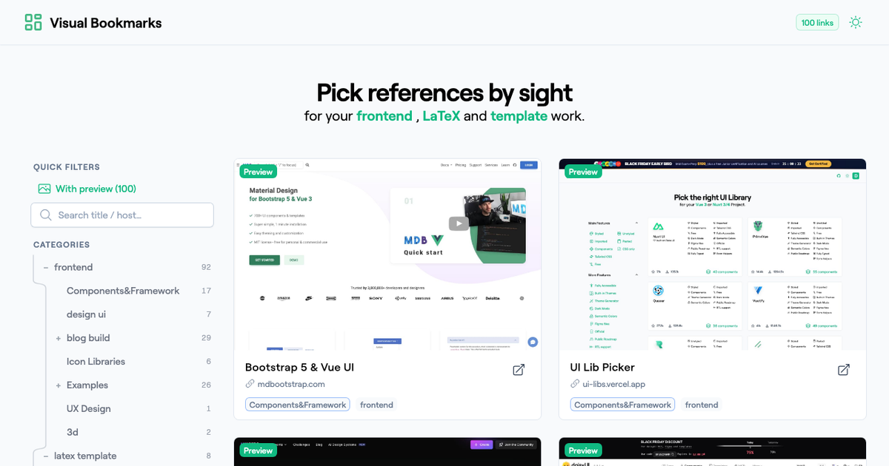

# Visual Bookmarks

[](https://wangzh12023.github.io/visual-bookmarks/)
[](./LICENSE)
[](https://nuxt.com/)
[](https://wangzh12023.github.io/visual-bookmarks/)

[English](./README.md) | **简体中文**

> 用**眼睛**挑参考，而不是靠收藏夹里的文字标题。

面向 frontend / UI / 动效灵感与 LaTeX 模板的可视化书签画廊。带预览截图与可折叠分类树，方便你在做新站时快速扫过收藏。

<p align="center">
  <a href="https://wangzh12023.github.io/visual-bookmarks/">
    
  </a>
</p>

## 为什么做

收藏夹大多只有文字 caption。每次做新网站都要点开一堆链接才能想起视觉长什么样。Visual Bookmarks 把这些链接变成**可筛选的截图画廊**。

## 功能

- **视觉优先卡片** — 每个书签都有代表性预览图
- **可折叠分类树** — 父子目录层级清晰（frontend、examples、LaTeX templates…）
- **快捷筛选** — 搜索 +「仅看有预览」
- **Nuxt UI 质感** — 基于 [ui-libs](https://github.com/ddahan/ui-libs) 的选择器体验改造
- **静态部署** — 开箱即用 GitHub Pages

## 演示

**在线：** https://wangzh12023.github.io/visual-bookmarks/

**仓库：** https://github.com/wangzh12023/visual-bookmarks

## 快速开始

```bash
git clone https://github.com/wangzh12023/visual-bookmarks.git
cd visual-bookmarks
npm install
npm run dev
```

打开 http://localhost:3000

## 脚本

| 命令 | 说明 |
| --- | --- |
| `npm run dev` | 本地开发 |
| `npm run generate` | 生成静态站点（GitHub Pages） |
| `npm run preview` | 预览静态产物 |
| `npm run capture:previews` | 批量抓取预览图 |
| `npm run fix:previews` | 修复页脚 / 深链等坏图 |

## 数据

- `data/bookmarks.json` — 书签元数据与预览路径
- `public/previews/` — 预览图
- `scripts/parse-bookmarks.py` — 解析 Chrome/Edge 书签 HTML 导出

```bash
python3 scripts/parse-bookmarks.py /path/to/bookmarks.html
```

## 部署（GitHub Pages）

推送到 `main` 会触发 [`.github/workflows/deploy-pages.yml`](./.github/workflows/deploy-pages.yml)：

1. `npm ci`
2. `NUXT_APP_BASE_URL=/visual-bookmarks/ npm run generate`
3. 将 `.output/public` 发布到 GitHub Pages

首次推送后，如未自动开启，请到 **Settings → Pages → Source: GitHub Actions**。

## 技术栈

- [Nuxt 3](https://nuxt.com/)
- [Nuxt UI](https://ui.nuxt.com/)
- Tailwind CSS
- Playwright + Sharp（预览抓取工具）

## 致谢

界面骨架改编自 [ddahan/ui-libs](https://github.com/ddahan/ui-libs)（MIT）。

## 参与贡献

欢迎 Issue / PR，详见 [CONTRIBUTING.md](./CONTRIBUTING.md)。

## 许可证

[MIT](./LICENSE) © Zihan Wang · 原 ui-libs © David Dahan
